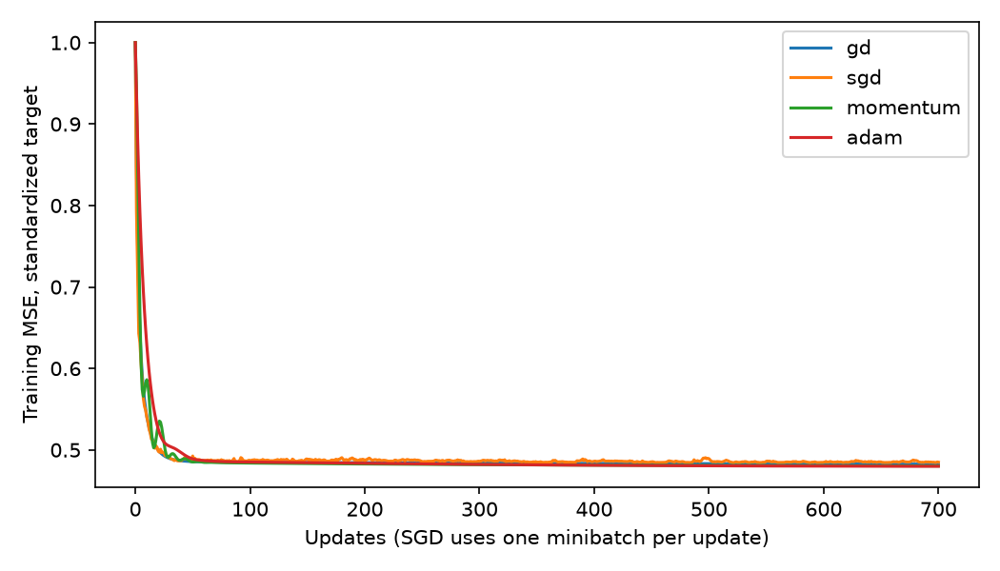
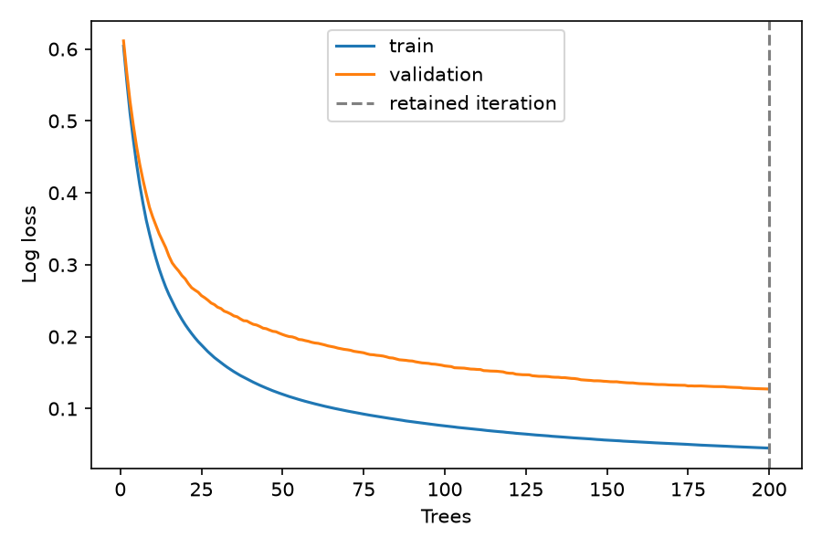

# ML Project

**Пять воспроизводимых экспериментов — от линейной регрессии до градиентного бустинга.**

Python 3.12 · NumPy · pandas · scikit-learn · Jupyter · pytest

Проект исследует обучение и оценку моделей на двух реальных наборах данных. Включает минимальные реализации четырёх оптимизаторов, бинарного дерева и логистического бустинга, сравнение со sklearn, графики и автоматическую проверку всех ноутбуков.

**Рабочая версия переработана с помощью Codex.** Она сохраняет пять тем первоначальных лабораторных, но использует новые данные и код. Это не копия всех заданий курса и не восстановленные результаты автора исходного репозитория. [Источники и авторство](ATTRIBUTION.md) · [Что изменилось](docs/MIGRATION.md).

## Посмотреть без установки Python

Откройте [обзорный ноутбук](notebooks/00-project-overview.ipynb). Все ноутбуки в поставке уже выполнены: таблицы, выводы и графики видны прямо на GitHub.

| Модуль | Эксперимент | Реализация |
|---|---|---|
| [01 · Регрессия](notebooks/01-regression.ipynb) | EDA, Dummy baseline, Ridge, Lasso, выбор alpha | sklearn Pipeline |
| [02 · Оптимизация](notebooks/02-optimization.ipynb) | GD, SGD, Momentum, Adam; четыре потери и L2 | [optimizers.py](mlproject/optimizers.py) |
| [03 · Классификация](notebooks/03-classification.ipynb) | Logistic Regression, SVM, калибровка вероятностей | Pipeline + CalibratedClassifierCV |
| [04 · Деревья](notebooks/04-trees.ipynb) | Собственный CART против sklearn | [tree.py](mlproject/tree.py) |
| [05 · Бустинг](notebooks/05-boosting.ipynb) | Logistic gradient boosting, shrinkage, early stopping | [boosting.py](mlproject/boosting.py) |

## Данные

| Набор | Задача | Объекты × признаки | Train / validation / test |
|---|---|---:|---:|
| Diabetes | Регрессия количественной цели | 442 × 10 | 264 / 89 / 89 |
| Wisconsin Diagnostic Breast Cancer | Бинарная классификация | 569 × 30 | 341 / 114 / 114 |

Данные входят в scikit-learn: **не нужны CSV, Kaggle, токены или сеть после установки**. Для классификации положительный класс — malignant (1). Метрики относятся к учебному эксперименту, не к клинической системе.

## Полученные результаты

Параметры выбирались по validation; ниже результаты отдельной test-выборки. Seed 42. В классификации порог фиксирован на 0.5. Сравнение одного split не доказывает универсальное превосходство алгоритма.

| Регрессия · Diabetes | Test RMSE ↓ | Test R² ↑ |
|---|---:|---:|
| Baseline среднего | 72.900 | −0.003 |
| Ridge | 54.031 | 0.449 |
| Lasso | **53.302** | **0.464** |

Lasso выбран по validation RMSE среди двух регуляризованных моделей. Его test RMSE ниже baseline примерно на 26.9%.

| Классификация · WDBC | Test Accuracy | Test ROC-AUC |
|---|---:|---:|
| Baseline prior | 0.632 | 0.500 |
| Logistic Regression | 0.974 | 0.9954 |
| Калиброванный SVM | 0.974 | 0.9944 |
| Собственный CART | 0.921 | 0.9673 |
| sklearn CART | 0.921 | 0.9673 |
| Собственный logistic boosting | 0.974 | 0.9967 |
| sklearn Gradient Boosting | 0.965 | 0.9924 |

Таблица показывает сравнение, а не выбор победителя по test. В модуле 03 по validation выбран SVM; в модуле 05 лучшая validation ROC-AUC у sklearn boosting. На test порядок может меняться. Точность своего CART совпала со sklearn при выбранных depth=3 и min_samples_leaf=8.





CSV с параметрами и метриками лежат в [reports](reports). [Методология](docs/METHODS.md) описывает разделение данных, сетки параметров, ограничения и значения метрик.

## Проверка через GitHub — без Python на ноутбуке

После загрузки **всей рабочей версии**, включая `.github/workflows/verify.yml`:

1. Откройте вкладку **Actions** в репозитории.
2. Выберите **Verify ML project**.
3. Нажмите **Run workflow → Run workflow**.
4. Дождитесь зелёного результата. Внизу запуска скачайте artifact **ml-project-results** с CSV, графиками и выполненными ноутбуками.

Workflow также запускается при push и pull request. До первого успешного облачного запуска наличие файла workflow само по себе не означает, что CI прошёл. Локальный отчёт проверки находится в `reports/verification.json`.

## Локальный запуск

```bash
python -m venv .venv
# Windows PowerShell:
.venv/Scripts/Activate.ps1
# macOS/Linux: source .venv/bin/activate
python -m pip install -r requirements.txt
python scripts/verify.py
```

Одна команда выполняет **тесты → пять экспериментов → шесть ноутбуков в чистых ядрах**. Любая ошибка завершает процесс с ненулевым кодом. Ноутбуки сохраняются с новыми выводами.

Отдельные команды:

```bash
python -m pytest -q
python scripts/run_all.py
python scripts/execute_notebooks.py
```

Для интерактивного редактирования можно отдельно установить JupyterLab: `python -m pip install jupyterlab`, затем выполнить `jupyter lab`.

## Что именно проверяется

- Градиенты MSE, MAE, Huber и LogCosh сравниваются с конечными разностями, с L2 и без него.
- L2 не изменяет исходные веса и не штрафует intercept.
- Все четыре оптимизатора сходятся на контролируемой задаче; повторный fit воспроизводим.
- CART выбирает тот же допустимый порог, что полный перебор; обрабатывает константные признаки и чистый класс.
- Бустинг корректно применяет learning rate, выдаёт нормированные вероятности и восстанавливает лучший ансамбль по validation.
- Индексы train/validation/test не пересекаются.
- Все кодовые ячейки всех шести ноутбуков исполняются без пропуска ошибок.

## Структура

```text
.github/workflows/  автоматическая проверка в GitHub
mlproject/          данные, алгоритмы, единый протокол экспериментов
notebooks/          обзор + пять выполненных лабораторных модулей
scripts/            запуск и полная проверка
tests/              тесты вычислений
reports/            CSV, графики и отчёты выполнения
docs/               методология и переход с первой версии
```

## Ограничения

Это небольшой учебный проект, не production-сервис. Нет внешней валидации, confidence intervals и оценки на нескольких seeds. Собственный CART работает только с числовыми признаками и бинарными метками; GOSS, квантование и Bayesian bootstrap не реализованы и не заявляются. Исходные домашние задания с Taxi, Autos и другими датасетами не исполняются в этой версии.
